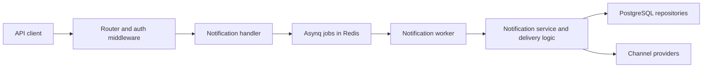

# Iwifunni Notifications: separating acceptance from delivery

## Problem

Email, SMS, and push delivery depend on external providers whose response times and failure
modes differ. Iwifunni separates accepting notification work from delivering it, and stores
configuration and delivery state alongside the tenant context.

This is the notification repository, separate from the
[feature-management platform](https://github.com/deveasyclick/feature-flags) that also uses
the Iwifunni name.

## Architecture



The diagram summarizes the asynchronous path. The handler also exposes dashboard test-send
and workflow-trigger routes; their behavior should not be inferred from this diagram.

## Decisions and tradeoffs visible in the implementation

- **Queue-backed delivery decouples work.** Redis and Asynq let acceptance and external delivery
  run separately. Acceptance therefore does not mean delivery succeeded, and operating the
  system requires both the queue and the workers.
- **Retry and uniqueness are queue options.** The producer sets retry, timeout, and uniqueness
  options explicitly. These reduce repeated work in bounded circumstances; they do not
  establish exactly-once delivery through an external provider.
- **Routing and composition stay separate.** `internal/app` wires the dependencies and routes;
  notification handling, business behavior, and persistence live in the notification module.
  The separation adds files but makes individual responsibilities easier to inspect and test.
- **Tenant context is part of delivery.** Project-scoped provider configuration and notification
  state are part of the data model. A provider abstraction alone does not provide tenant
  isolation; the auth and repository paths must preserve that scope.

## Read the implementation

- [Application composition](../internal/app/app.go)
- [Route composition](../internal/app/routes.go)
- [Notification handler](../internal/modules/notification/handler.go)
- [Queue producer and task options](../internal/queue/asyncq.go)
- [Worker](../internal/modules/notification/worker.go)
- [Delivery behavior](../internal/modules/notification/delivery.go)
- [Service tests](../internal/modules/notification/service_test.go)
- [Worker tests](../internal/modules/notification/worker_test.go)

## Operational check

With the API running on the port configured for your environment:

```bash
curl --fail http://localhost:8080/health
```

Confirm the actual configured port before using this example. The health handler checks
PostgreSQL and Redis and returns a degraded response when either check fails. Passing health
is infrastructure evidence; it does not verify a provider delivered a message.

## Status

These notes document code structure and the asynchronous path, without claiming a measured
throughput, delivery success rate, or production user count. Some older architecture documents
use different source paths; the linked current modules are the implementation references
for these notes. Provider delivery still requires valid configuration and an end-to-end
integration check.
